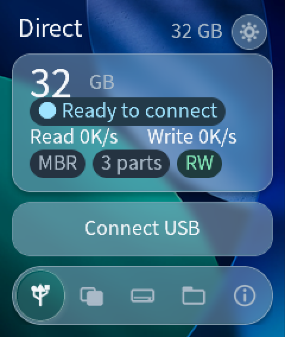

# CardSight

[](https://github.com/YuzukiHD/CardSight/actions/workflows/ci.yml)
[](https://yuzukihd.github.io/CardSight/)
[](LICENSE)

CardSight is a **TF card proxy system** for the Yuzuki CardSight board (Allwinner V861/V881,
XuanTie C907). It reads a TF card's partition table, formats and browses its filesystems, and
exports the card or a synthesized exFAT view over USB. The five-page touch UI runs on a 240×284
ST7789 panel; a serial shell covers diagnostics and recovery.



## Quick start

```sh
git clone --recurse-submodules https://github.com/YuzukiHD/CardSight.git
export XUANTIE_TOOLCHAIN=/path/to/Xuantie-900-gcc-elf-newlib-x86_64-V3.2.0
cd CardSight/software && cmake --preset riscv && cmake --build build/riscv
# then load the three images through FEL; see the boot guide
```

No prebuilt images are published. The build produces `cardsight.bin`, `init_psram_efex.bin` and
`c907_boot_efex.bin` under `software/build/riscv/images/`.

## Documentation

<https://yuzukihd.github.io/CardSight/>

| Section | Start with |
| --- | --- |
| Getting started | [Overview](https://yuzukihd.github.io/CardSight/), [Quick start](https://yuzukihd.github.io/CardSight/getting-started/quick-start/), [Flashing and boot](https://yuzukihd.github.io/CardSight/getting-started/flashing/) |
| Using CardSight | [On-screen UI](https://yuzukihd.github.io/CardSight/guide/ui/), [Card and files](https://yuzukihd.github.io/CardSight/guide/card-files/), [USB export](https://yuzukihd.github.io/CardSight/guide/usb-export/) |
| Live demo | [WebAssembly UI simulator](https://yuzukihd.github.io/CardSight/#try-it) |
| Reference | [Shell commands](https://yuzukihd.github.io/CardSight/reference/cli/), [Configuration](https://yuzukihd.github.io/CardSight/reference/configuration/), [Hardware](https://yuzukihd.github.io/CardSight/reference/hardware/), [C API](https://yuzukihd.github.io/CardSight/reference/api/) |
| Development | [Build](https://yuzukihd.github.io/CardSight/development/build/), [Testing](https://yuzukihd.github.io/CardSight/development/testing/), [Architecture](https://yuzukihd.github.io/CardSight/development/architecture/), [Porting](https://yuzukihd.github.io/CardSight/development/porting/) |
| Project | [FAQ](https://yuzukihd.github.io/CardSight/project/faq/), [Changelog](CHANGELOG.md), [Security](SECURITY.md), [License](https://yuzukihd.github.io/CardSight/project/license/) |

The documentation sources are in [`docs/`](docs/). The site is built with Astro/Starlight, and the
[simulator on its overview page](https://yuzukihd.github.io/CardSight/#try-it) is the real LVGL UI
compiled to WebAssembly.

## Supported hardware

| Item | Detail |
| --- | --- |
| Board | Yuzuki CardSight, Allwinner V861/V881 (`sun252iw1`) |
| CPU | XuanTie C907 (RV32, `rv32imafdc_zicsr_zifencei`, ilp32d); E907 boot core |
| Memory | 128 KiB on-chip SRAM, 8 MiB PSRAM |
| Display | ST7789 240×284, SPI1, RGB888 data path |
| Card | SMHC0, TF card, SDR104/SDR50/SDR25, 1.8 V switching |
| USB | MUSB device controller, CherryUSB MSC |
| Console | UART0, PH13/PH14, 115200 8N1 |

Schematics, PCB and BOM are not published in this repository yet. Only `master` is maintained;
there are no release branches. See [CHANGELOG.md](CHANGELOG.md) for the current source snapshot.

## Contributing

Read [CONTRIBUTING.md](CONTRIBUTING.md) and the [Code of Conduct](CODE_OF_CONDUCT.md). Use
[SUPPORT.md](SUPPORT.md) for questions and [SECURITY.md](SECURITY.md) for vulnerabilities.

## License

CardSight is released under GPL-2.0-or-later; see [LICENSE](LICENSE). Third-party components,
versions and their licenses are listed in [THIRD_PARTY.md](THIRD_PARTY.md). The generated font data
is shipped under the SIL Open Font License 1.1; see
[software/apps/cardsight/FONT_LICENSE.txt](software/apps/cardsight/FONT_LICENSE.txt).
