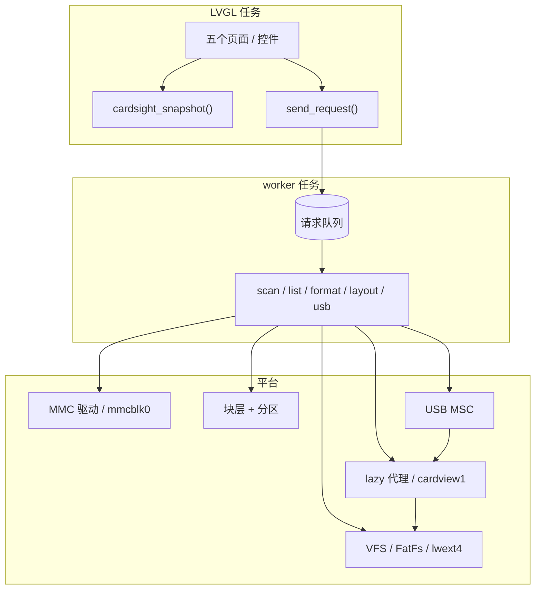

## 目录

```text
software/
├── board/          板级常量（UART、SD、SPI、屏、触摸、USB 缓冲地址）
├── include/        公开 API（vfs.h、hal/*、gui/lvgl_port.h）
├── src/            启动、内核胶水、驱动、块层、VFS、USB、LVGL 端口
├── apps/cardsight/ app/、storage/、ui/、fonts/、assets/
├── tests/          host/（主机测试、PPM 渲染器）与 wasm/（浏览器模拟器）
├── patches/        CherryUSB、lwext4 的板级补丁
└── third_party/    六个 submodule
```

## 启动

`src/arch/start.S` 设置栈、清 `.bss`、跳到 `main()`。`main()` 初始化控制台和日志，然后按
`INITCALL(level, priority, fn)` 注册的顺序执行初始化：时钟和引脚、UART、块层、MMC、文件系统、
显示、触摸、USB、应用和界面任务。需要调度器的初始化放在 level 3。

两个 eFEX 不属于固件镜像：它们由 SyterKit 的板配置单独构建，通过 FEL 写入 SRAM 运行。

## 任务与请求

界面任务只读状态快照，不直接碰卡：



worker 一次只执行一个请求。状态由 `app_lock` 保护，界面拿到的是副本，不会看到写了一半的字段。
请求类型固定为七种：扫描、直连 USB、启动代理、停止、格式化分区、重建布局、列目录。界面不能
绕过 worker 直接调用文件系统或 USB。

LVGL 自己有一个任务，所有控件操作都在这个任务里执行。其他任务通过 `lvgl_port_post()` 投递
回调，不直接调用 LVGL。触摸由 LVGL 输入设备轮询，没有中断或独立线程。

热插拔由 MMC 驱动的低优先级任务处理：插入时识别并发布磁盘，拔出时撤下磁盘。worker 发现磁盘
消失后停止 USB 和代理，再清空属于旧卡的状态。

## 存储代理的拆分

懒索引引擎按能力拆文件，公共接口在 `proxy_lazy.h`，内部类型和共享状态在 `lazy_types.h`，
跨模块原型在 `lazy_private.h`：

| 文件 | 能力 |
| --- | --- |
| `lazy_lifecycle.c` | 启动、停止、探测源分区、构建根目录 |
| `lazy_volume.c` | 视图几何、预留区、引导区、FAT |
| `lazy_dir*.c` | 目录头、槽位、名称、缓存加载 |
| `lazy_cache.c` | LRU 记账与淘汰 |
| `lazy_range.c` | 簇区间到源文件的映射 |
| `lazy_read.c` / `lazy_write*.c` | 读路径、写回路径、overlay |
| `lazy_staging.c` | staging 文件与 flush |
| `lazy_render.c` | 目录项、文本报告的字节布局 |
| `lazy_shell.c` | `lazyproxy` 命令 |

全量索引引擎在 `storage/eager/`，结构与它类似，但启动时遍历源目录并建立完整索引。两者都通过
`storage_proxy.h` 暴露分区信息，界面不依赖具体引擎。

## 界面拆分

`ui/core/` 放外壳、标签栏、对话框、横幅和错误卡片；`ui/widgets/` 放按钮、列表、文本等构造函数；
`ui/pages/` 一页一个文件。页面构建函数只负责一次性建立控件树，运行中的数值由 `ui_update_*`
原地更新。`ui_private.h` 保存控件指针和布局常量，页面之间不互相引用。

界面重建时先保存每个列表的滚动位置，清空整棵树，再重新构建五个页面。重建只在状态结构变化时
发生；速率、进度、错误这类连续变化走原地更新，避免每秒重建。

## 测试与模拟器

主机测试编译真实的块层、VFS、FatFs、lwext4 和两个代理引擎，用 RAM 盘代替 SD 卡。板级驱动、
DMA、缓存维护这些依赖寄存器的代码不进入主机目标。

`tests/host/ui_sim.c` 编译真实 LVGL 和全部界面代码，把页面和交互状态渲染成 PPM。它和主机测试
共用 `tests/host/stubs/` 里的 `FreeRTOS.h`、显示和日志桩。

`tests/wasm/` 用同一套界面源码构建浏览器里的模拟器，额外提供内存 framebuffer、指针输入和
请求模拟。文档站的 `docs/public/demo/cardsight-demo.js` 负责实例化、转发触摸事件和把 RGB565
帧画到 canvas。模拟器和固件使用同一份 `lv_conf.h` 与字体，不维护第二套界面。
