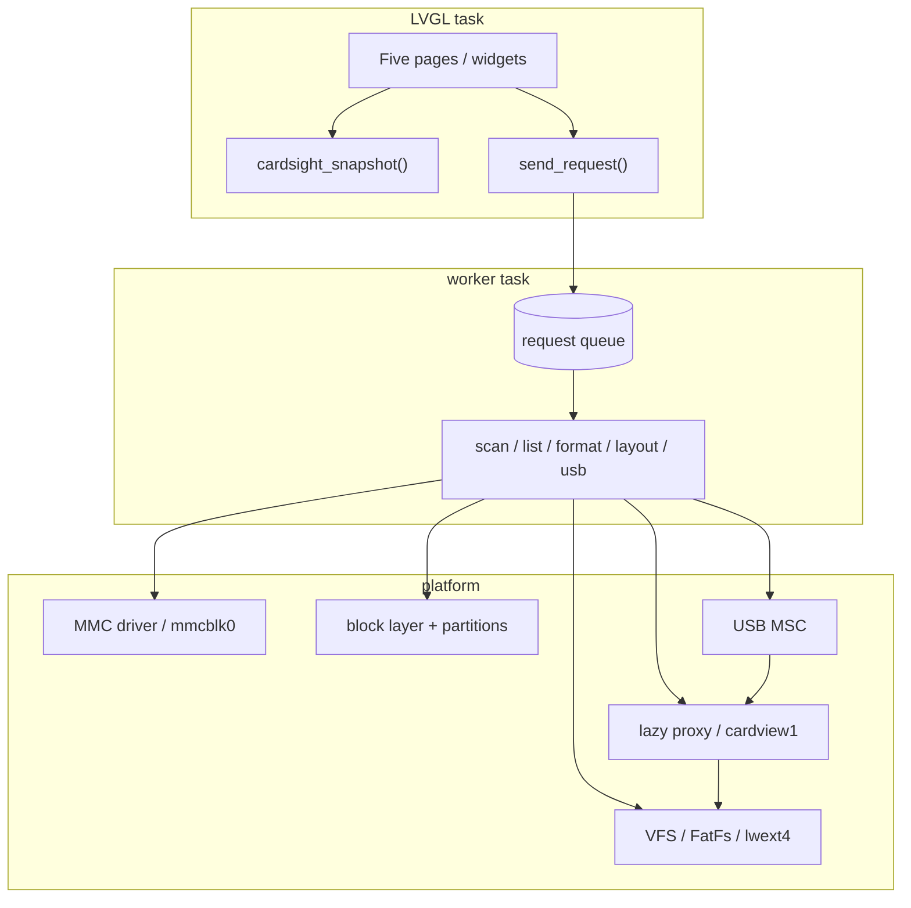

## Layout

```text
software/
├── board/          Board facts (UART, SD, SPI, panel, touch, USB buffer addresses)
├── include/        Public API (vfs.h, hal/*, gui/lvgl_port.h)
├── src/            Boot, kernel glue, drivers, block layer, VFS, USB, LVGL port
├── apps/cardsight/ app/ · storage/ · ui/ · fonts/ · assets/
├── tests/          host/ (host tests, PPM renderer) and wasm/ (browser simulator)
├── patches/        Board patches for CherryUSB and lwext4
└── third_party/    Six submodules
```

## Boot

`src/arch/start.S` sets up the stack, clears `.bss` and jumps to `main()`. `main()` initialises the
console and logging, then runs initialisation in the order registered with
`INITCALL(level, priority, fn)`: clocks and pins, UART, block layer, MMC, filesystems, display,
touch, USB, application and UI tasks. Initialisation that needs the scheduler is at level 3.

The two eFEX images are not part of the firmware image: SyterKit's board configuration builds them
separately, and they run from SRAM after being loaded through FEL.

## Tasks and requests

The UI task reads a state snapshot and never touches the card directly:



The worker runs one request at a time. State is protected by `app_lock`, and the UI receives a copy,
so it never observes a half-written field. There are seven request types: scan, direct USB, start
proxy, stop, format partition, rebuild layout and list directory. The UI cannot bypass the worker
to call a filesystem or USB directly.

LVGL has its own task, and every widget operation runs there. Other tasks submit callbacks with
`lvgl_port_post()` instead of calling LVGL directly. Touch is polled by the LVGL input device; there
is no interrupt or separate thread.

Hot-plug is handled by a low-priority MMC driver task: it identifies and publishes the disk on
insertion and removes it on removal. When the worker sees the disk disappear, it stops USB and the
proxy, then clears the state that belonged to the old card.

## Storage-proxy split

The lazy engine splits by capability. The public interface is `proxy_lazy.h`, shared types and
state are in `lazy_types.h`, and cross-module prototypes are in `lazy_private.h`:

| File | Capability |
| --- | --- |
| `lazy_lifecycle.c` | Start, stop, source probing, root construction |
| `lazy_volume.c` | View geometry, reservations, boot region, FAT |
| `lazy_dir*.c` | Directory headers, slots, names, cache loading |
| `lazy_cache.c` | LRU accounting and eviction |
| `lazy_range.c` | Cluster-run mapping to source files |
| `lazy_read.c` / `lazy_write*.c` | Read path, write-back path, overlay |
| `lazy_staging.c` | Staging files and flush |
| `lazy_render.c` | Byte layout of directory entries and text reports |
| `lazy_shell.c` | The `lazyproxy` command |

The full-index engine in `storage/eager/` follows the same structure but walks the source tree at
start-up and builds a complete index. Both expose partition information through `storage_proxy.h`;
the UI does not depend on a specific engine.

## UI split

`ui/core/` holds the shell, tab bar, dialogs, banner and error sheet; `ui/widgets/` holds the
button, list and text constructors; `ui/pages/` has one file per page. Page builders create the
widget tree once, and `ui_update_*` refreshes live values in place. `ui_private.h` owns the widget
pointers and layout constants, and pages do not reference each other.

A rebuild first saves each list's scroll position, clears the whole tree, then rebuilds all five
pages. Rebuilds happen only when the state structure changes; continuous values such as rates,
progress and errors update in place, so the UI is not rebuilt every second.

## Tests and the simulator

The host tests compile the real block layer, VFS, FatFs, lwext4 and both proxy engines, using RAM
disks instead of an SD card. Board drivers, DMA and cache maintenance, which depend on registers,
do not enter the host target.

`tests/host/ui_sim.c` compiles the real LVGL and all UI code and renders pages and interaction
states to PPM. It shares the `FreeRTOS.h`, display and logging stubs in `tests/host/stubs/` with the
host tests.

`tests/wasm/` builds the same UI sources for the browser and adds a memory framebuffer, pointer
input and the request emulator. `docs/public/demo/cardsight-demo.js` instantiates the module,
forwards touch events and draws the RGB565 frame on a canvas. The simulator and the firmware use the
same `lv_conf.h` and fonts; there is no second UI implementation.
