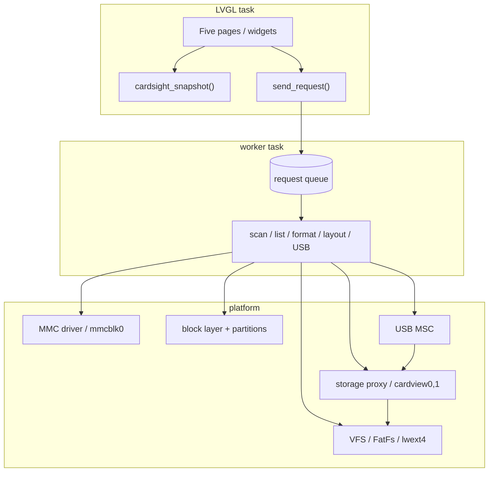

## Source map

| Path | Responsibility |
| --- | --- |
| `software/board/` | Board constants and linker script |
| `software/include/` | Public headers |
| `software/src/arch/` | Boot, traps, PLIC, CLINT, cache |
| `software/src/kernel/` | FreeRTOS glue, initcall, console, shell, logging |
| `software/src/drivers/` | UART, MMC/SD, SPI, I2C, panel, touch, CCU, pinctrl |
| `software/src/block/` | gendisk, block devices, MBR/GPT parsing, layout writing |
| `software/src/fs/` | VFS, FatFs and lwext4 glue |
| `software/src/gui/` | LVGL port |
| `software/src/usb/` | MUSB and CherryUSB MSC |
| `software/apps/cardsight/app/` | State model, worker, card/files/format/layout operations, diagnostics |
| `software/apps/cardsight/storage/lazy/` | Lazy-index exFAT view `cardview1` |
| `software/apps/cardsight/storage/eager/` | Full-index exFAT view `cardview0` |
| `software/apps/cardsight/ui/` | Theme, widgets and the five pages |
| `software/tests/host/` | Ram-disk tests and `ui_sim` |
| `software/tests/wasm/` | Browser simulator |

## Boot and initcall order

`src/arch/start.S` configures the machine, caches, FPU/VPU, clears `.bss` on hart 0 and starts hart
1 as the panel pixel worker. `main()` brings up the polled UART, CLINT and PLIC, runs initcall
levels 0 and 1 on the boot stack, starts the boot task, then runs levels 2 and 3 from that task
before entering the application.

Registration is `INITCALL(level, priority, function)`. Storage filesystems and USB storage initialise
early; console RX, touch, display and the MMC host follow; the panel worker, shell, storage-proxy
engines, LVGL and the MMC hot-plug task are level 3.

The two eFEX images are separate SyterKit builds, not part of the application image. See
[Flashing and boot](../getting-started/flashing.md).

## Tasks and requests

The shell task runs at priority 3, the LVGL and worker tasks at priority 2, and the MMC hot-plug
task at priority 1. The panel worker runs on hart 1. LVGL is single-threaded; other tasks reach it
through `lvgl_port_post()`.

The UI never touches the card. It reads a snapshot and posts one of seven request types: scan,
start direct USB, start proxy, stop, format, layout, or list directory. The queue holds six
requests, the worker runs one at a time, and `app_lock` protects the shared state.

## Storage stack

- `gendisk` and `block_device` provide the disk and partition view; MBR and GPT are parsed in
  `src/block/partition.c` and a layout writer rebuilds tables.
- The VFS mounts `fat`/`fat32`/`exfat` through FatFs and `ext` through lwext4.
- FatFs and lwext4 are copied into the build directory, where the project configuration and board
  patches are applied. The patches and their rationale are in
  [THIRD_PARTY.md](https://github.com/YuzukiHD/CardSight/blob/master/THIRD_PARTY.md).
- The block layer, VFS and filesystem glue do not depend on board headers and compile in the host
  tests.

## Storage proxy

Two engines create an exFAT view over selected source partitions:

- `storage/lazy/` indexes a directory when the host reads it, keeps a bounded LRU and implements
  write-back through an overlay and staging files. It registers `cardview1` and is used by the UI.
- `storage/eager/` walks the source tree at start-up, keeps a full index and registers `cardview0`.
  It is kept for diagnostics.

The internals, capacity rules and limits are in
[Storage proxy internals](storage-proxy.md). The user-facing export steps are in
[USB export](../guide/usb-export.md).

## UI

`ui/core/` holds the shell, tab bar, dialogs, banner and error sheet. `ui/widgets/` holds the button,
list and text constructors. `ui/pages/` has one file per page. A page builder creates its tree once;
`ui_update_*` refreshes live values in place.

A rebuild saves each list's scroll position, clears the tree and rebuilds the five pages. Continuous
values such as rates, progress and errors update in place, so the UI is not rebuilt every second.

The panel uses RGB888 over the SPI path; the browser simulator uses an RGB565 framebuffer for the
canvas. See [Hardware](../reference/hardware.md) for the panel details.

## Tests and API

Host tests compile the real block layer, VFS, filesystems and both proxy engines against RAM disks.
The WebAssembly simulator compiles the same UI. The suites and CI jobs are in [Testing](testing.md);
the public headers are published in the [C API](../reference/api.md).
